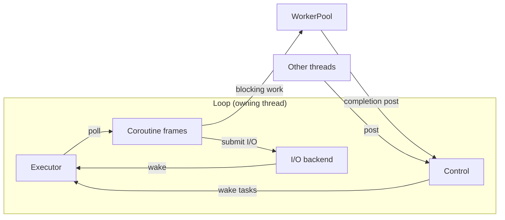

# velo

Stackless coroutines and async I/O for Zig 0.17. Coroutines are explicit state
machines: nothing switches stacks.

- **Coroutines:** executor, `Join`, `Race`, `Yield`, `Event`, `Semaphore`, `Channel`
- **Network:** TCP and UDP with deadlines, timeouts, and cancellation
- **Threads:** cross-thread posts into a loop; a bounded `WorkerPool` for blocking work
- **Files:** positional reads, writes, and sync on the worker pool
- **Backends:** io_uring with epoll fallback (Linux), kqueue (macOS), IOCP (Windows)

## Architecture



- `Frame(C)` holds a coroutine's state, task handle, and result. Its coroutine
  returns `.pending` to yield or `.ready` to finish; `Task.wake()` schedules another poll.
- `Loop` drives the executor and socket/timer operations through the selected backend.
  I/O completions wake waiting tasks.
- `Control` runs posted callbacks on the loop thread. `WorkerPool` executes blocking
  actions on worker threads and posts completions back to that loop.
- The executor also works without I/O. Independent loops can run on separate threads,
  each owning its tasks and communicating through posts.

## Usage

```sh
zig fetch --save git+https://github.com/tenyoru/velo
```

```zig
// build.zig
const velo = b.dependency("velo", .{ .target = target, .optimize = optimize });
exe.root_module.addImport("velo", velo.module("velo"));
```

```zig
const std = @import("std");
const velo = @import("velo");

pub fn main() !void {
    var loop = try velo.io.Loop.init(32);
    defer loop.deinit();

    var timer: velo.coroutines.Frame(velo.io.Timeout) = .{
        .coroutine = velo.io.Timeout.init(&loop, .{
            .duration = .{ .sec = 0, .nsec = 1_000_000 },
        }),
    };

    loop.executor.spawn(&timer.task);

    // A loop error cannot safely unwind storage the kernel still references.
    loop.run() catch |err| std.debug.panic("I/O loop failed: {s}", .{@errorName(err)});

    try timer.result.?;
}
```

## Rules

- Pin the loop, frames, buffers, and addresses until the result is consumed,
  including after cancellation.
- `cancel()` is a request: keep polling until ready. A late cancel can still
  succeed, so clean up whatever the result owns.
- A loop belongs to one thread. Other threads may call only `post`, `retain`,
  `release`, `stop`, and `shutdown`.
- The full contracts are doc comments; start with `src/coroutines/root.zig`
  and `src/io/root.zig`.

## Examples

```sh
zig build run-counters                 # two coroutines taking turns
zig build run-wakeup                   # cross-thread post, stop, and resume
zig build run-pipeline                 # Channel and Join over a bounded buffer
zig build run-echo                     # TCP echo server; press Enter to stop
zig build run-files -- /tmp/velo-demo  # pooled create, write, sync, and read
```

## Development

```sh
nix develop
just test                           # zig build test --summary all
just check -Dtarget=x86_64-windows  # link tests for another target
just fmt
```

ThreadSanitizer on Linux: `zig test src/root.zig -fllvm -fsanitize-thread -lc -j2`.
